# DownloadMaster

[](https://github.com/mothannakhzaleh/DownloadMaster/releases)
[](https://github.com/mothannakhzaleh/DownloadMaster/actions/workflows/ci.yml)
[](https://github.com/mothannakhzaleh/DownloadMaster/actions/workflows/release.yml)

An IDM-style download manager and media converter for **Windows, macOS and Linux**. Downloads videos from
1000+ sites (yt-dlp), Instagram profiles, and direct files over multiple connections; catches downloads and
videos straight from your browser with a Chrome / Edge extension; converts video, images, audio and text-to-speech.
Ships as one standalone app — nothing else to install.

---

## Screenshots

| Video downloads | Files + download queue |
|-----------------|------------------------|
| 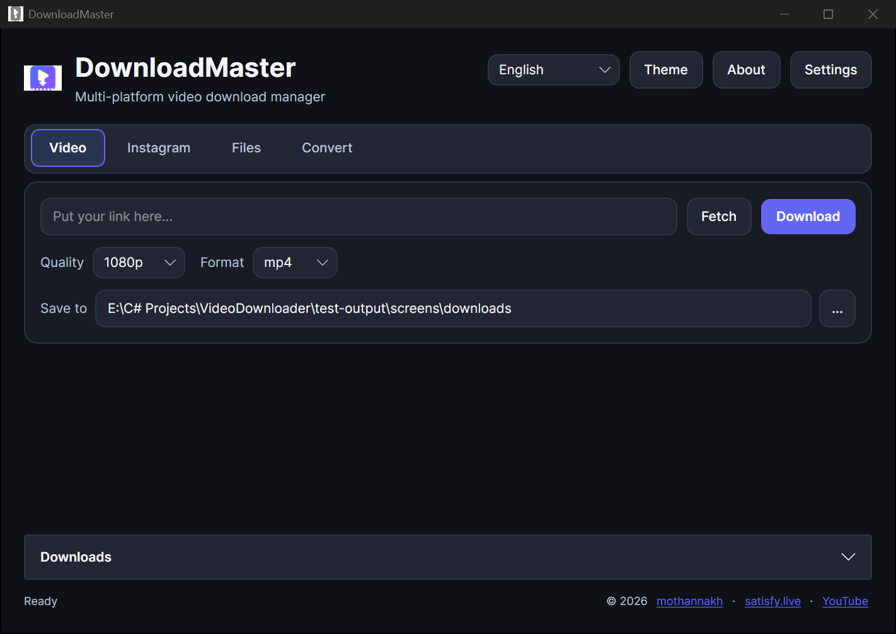 | 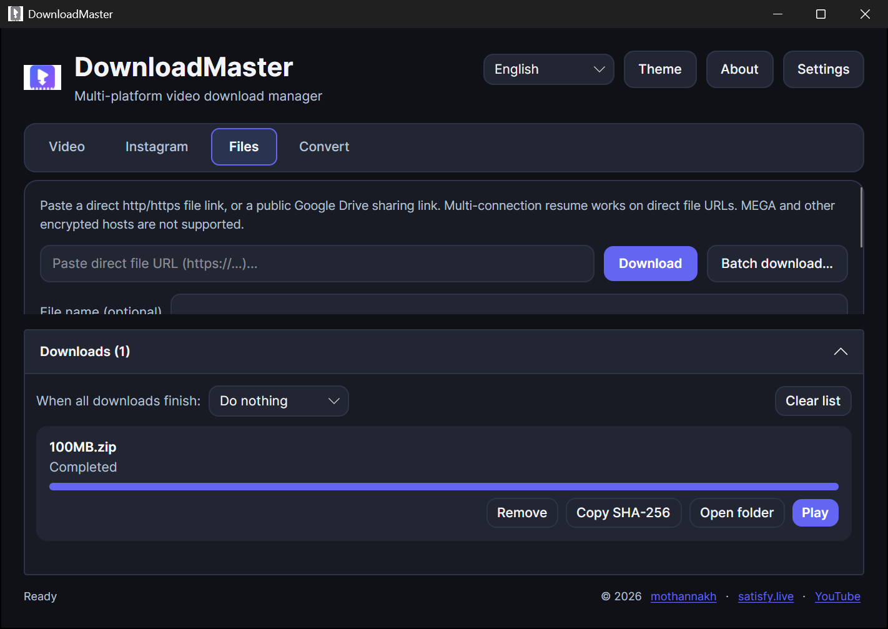 |

| Caught from the browser | Browser extension setup |
|-------------------------|-------------------------|
| 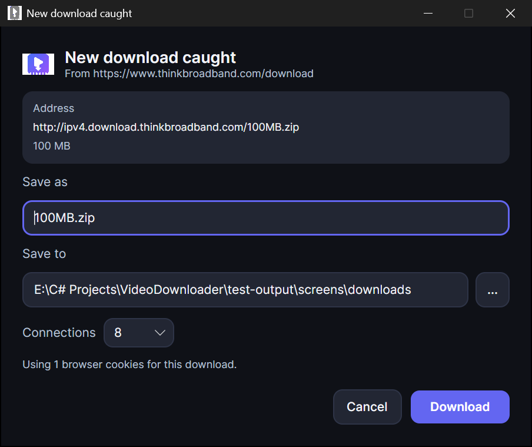 | 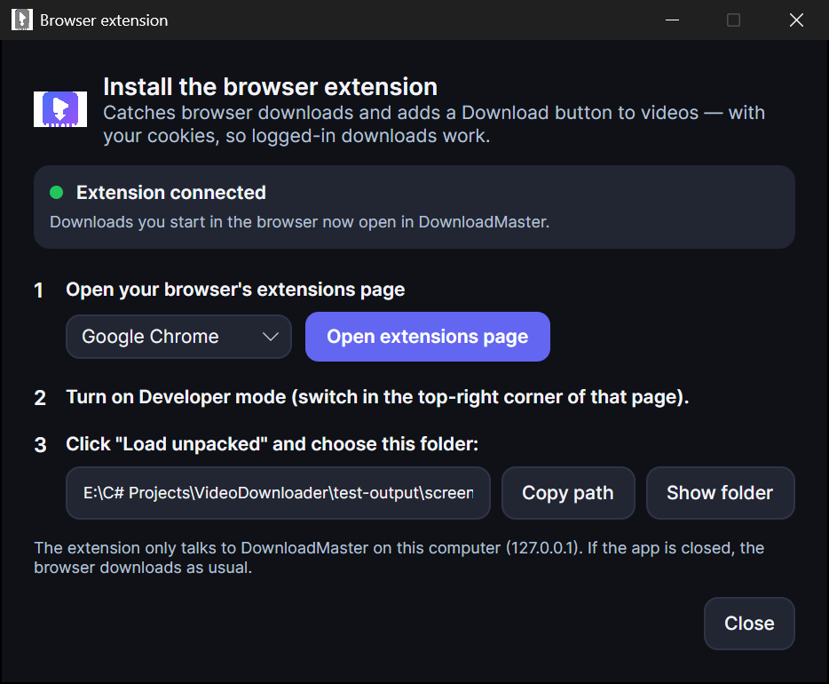 |

| Instagram | Files |
|-----------|-------|
| 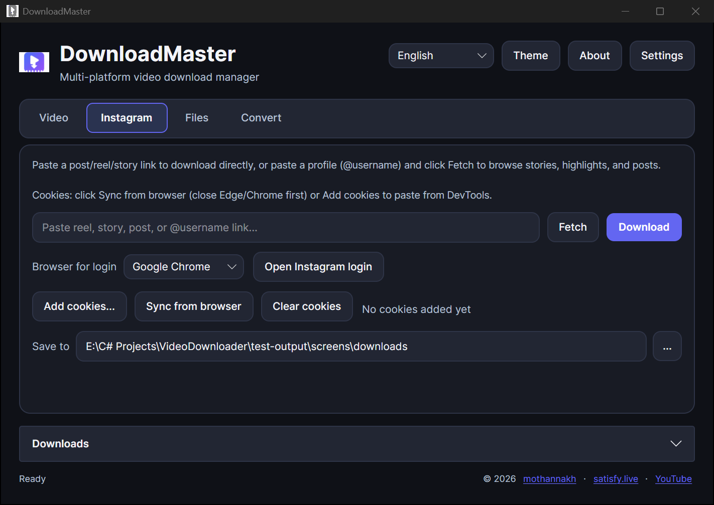 | 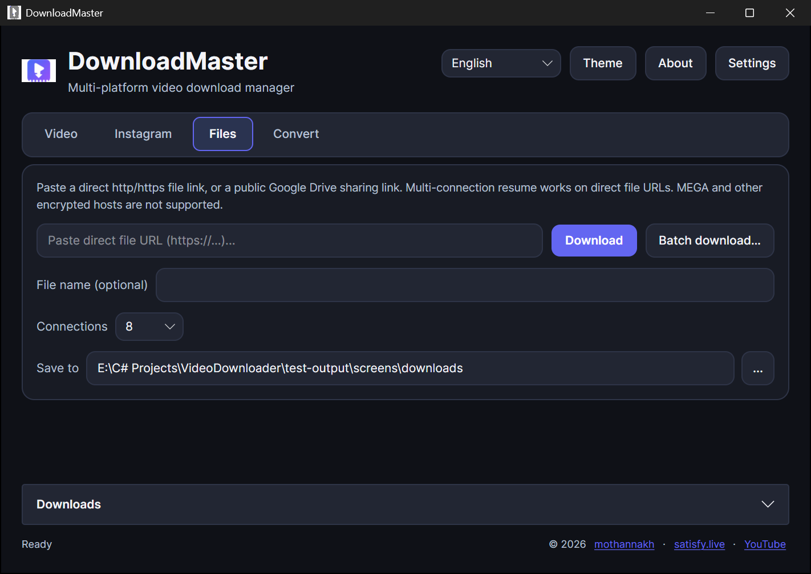 |

| Video Convert | Image Convert |
|---------------|---------------|
| 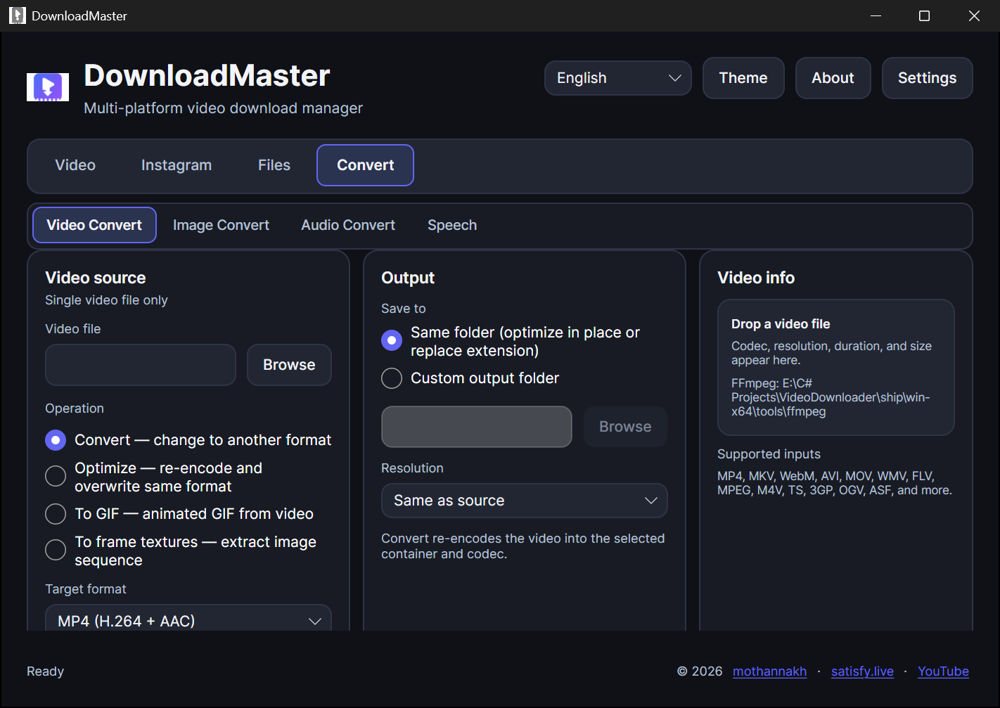 | 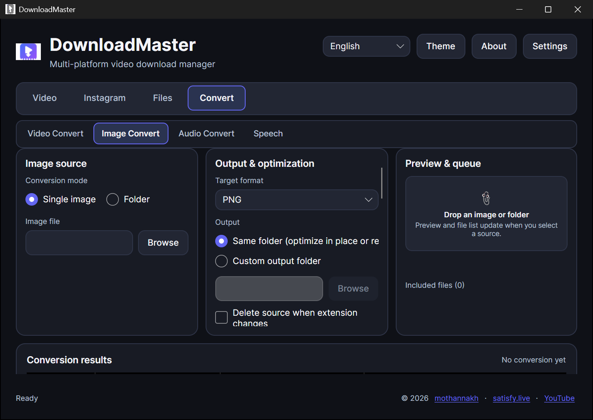 |

| Audio Convert | Speech |
|---------------|--------|
| 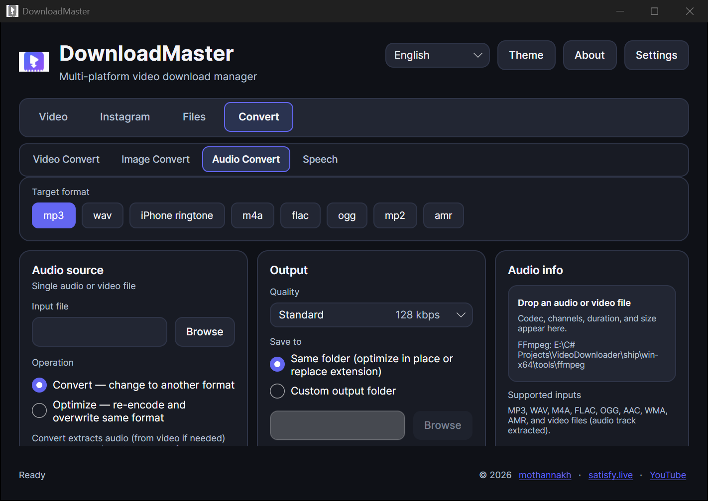 | 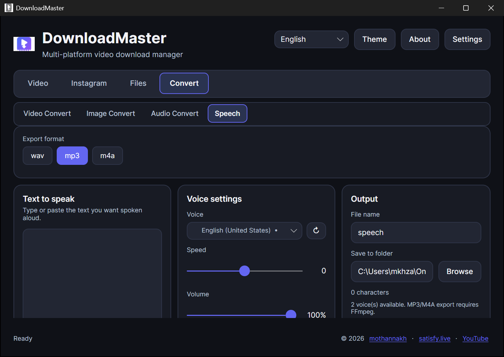 |

| Settings | Light theme |
|----------|-------------|
| 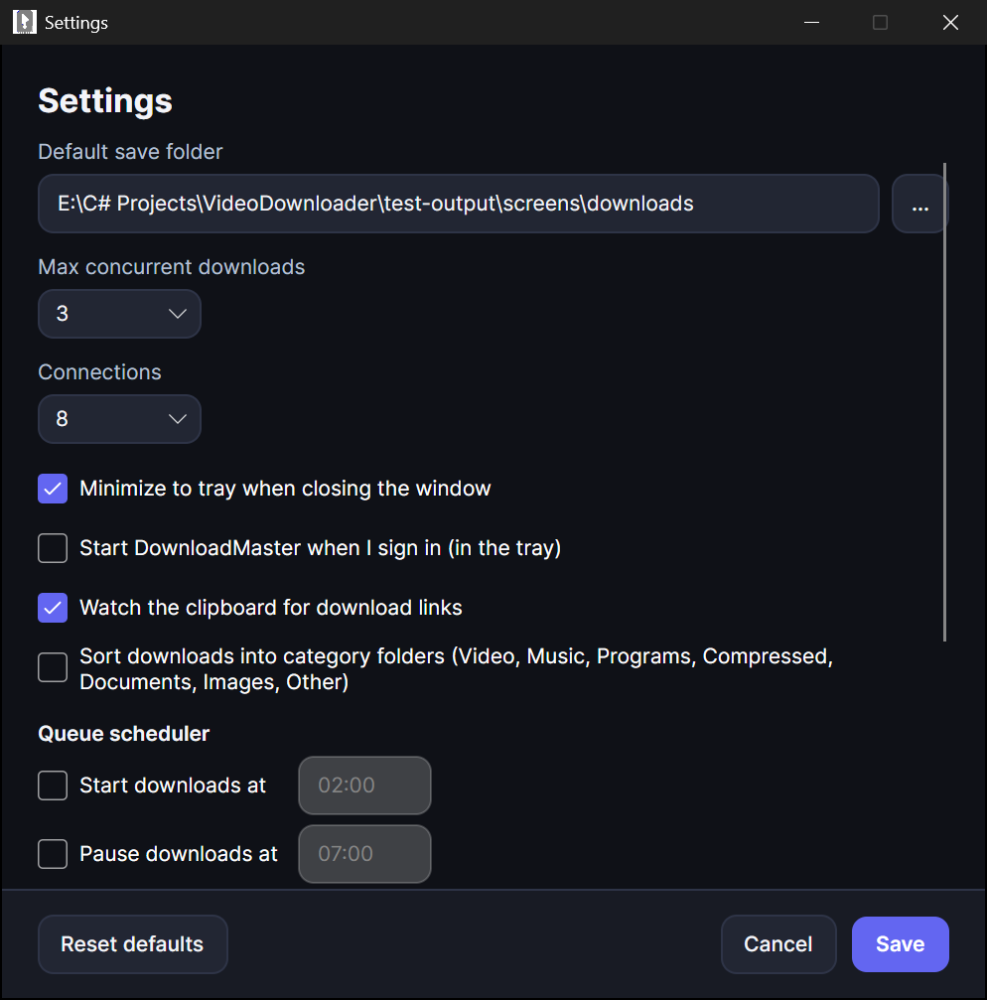 | 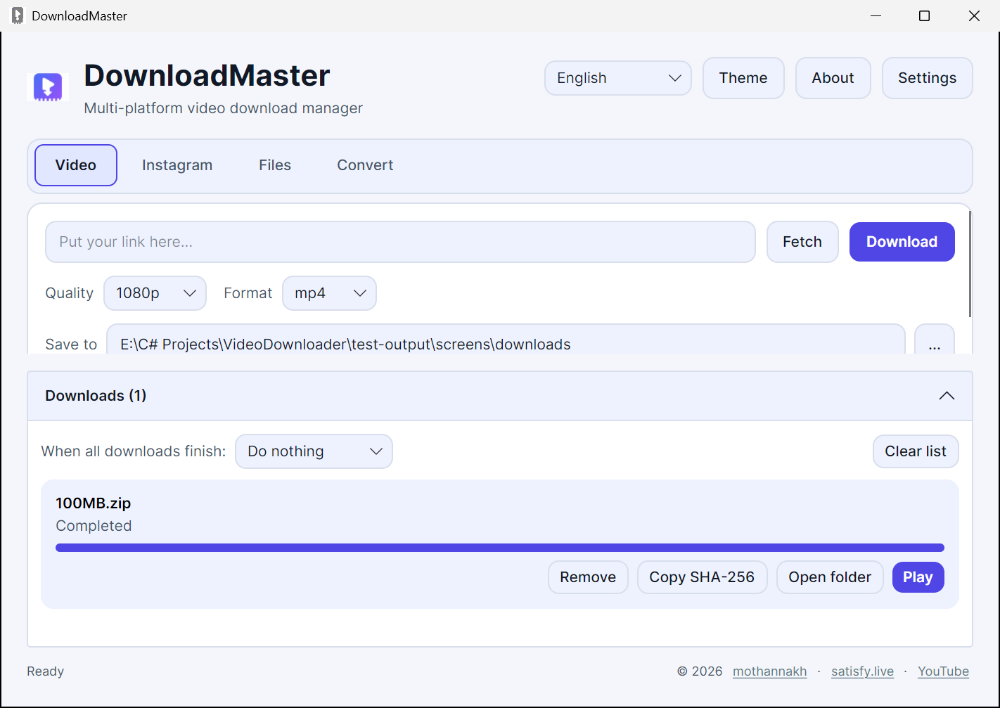 |

Screenshots are generated from the real app by [`scripts/screenshots.ps1`](scripts/screenshots.ps1).

---

## Features

### Browser extension (Chrome, Edge, Brave, Opera)
- **Catches browser downloads** and hands them to the app with your **cookies, referrer and user agent** — logged-in downloads just work, no cookie copying
- **"New download caught"** window pops up on top of the browser, even while the app sits in the tray
- **Download button on videos** — hover a video to send the page (yt-dlp, best quality) or a detected **HLS / DASH / MP4** stream
- **Refresh download address** — if a link expired, start it again in the browser and the app continues the old `.part` file
- Falls back to the browser's own download when the app isn't running
- **Install from the app**: tray menu or Settings → *Browser extension…* (see [src/browser-extension/README.md](src/browser-extension/README.md))

### Files (IDM-style engine)
- Direct http/https links and public **Google Drive** links
- **Up to 16 connections** with **dynamic segment splitting** — finished connections take over the slowest part
- **Per-connection progress bar**, pause / resume, crash-safe resume (state saved every second)
- **Global speed limiter** (tray: Unlimited / 2 MB/s / 500 KB/s)
- **SHA-256** shown after each download (*Copy SHA-256*)
- **Batch download** with patterns like `https://example.com/part_[01-20].rar`, `img_[a-f].jpg`, `[1-100:5]`
- **Category folders** (optional): Video, Music, Programs, Compressed, Documents, Images, Other

### Video (yt-dlp)
- YouTube, X/Twitter and 1000+ sites · fetch preview with auto-detected quality and format
- Playlists · progress, speed and ETA · **Open folder** and **Play** when done

### Instagram
- Download a **post / reel / story** link, or browse a **profile** (stories, highlights, posts) with thumbnails
- Carousel & highlight rows — one item or the whole batch
- Cookies: sync from Chrome / Edge / Brave / Firefox / Chromium, paste from DevTools, or clear

### Queue & automation
- **Scheduler**: start downloads at / pause downloads at a time of day
- **When all downloads finish**: nothing, sleep, shut down or quit (60-second countdown with Cancel)
- **Clipboard monitor**: copy a download link → the "download caught" window opens
- **Start with the OS** in the tray (Windows, macOS, Linux)

### Convert
- **Video** — convert format, optimize in place, **GIF**, **frame textures**; resolution presets; cancel
- **Image** — single image or **folder batch** (subfolders); PNG, JPEG, WebP, BMP, TIFF, GIF, TGA, DDS; optimize, PNG palette + dither, resize filters, colour depth, extension filters, transparent-pink texture keying, parallel conversion, live per-file results
- **Audio** — MP3, WAV, M4A, FLAC, OGG, MP2, AMR, iPhone ringtone (M4R); quality presets; extract audio from video
- **Speech** — text-to-speech with system voices (Windows voices, macOS `say`, Linux `espeak-ng`); export WAV / MP3 / M4A

### App
- **Windows, macOS and Linux** (Avalonia UI) · dark / light themes · English + Arabic (RTL)
- **Closes to the tray / menu bar** instead of quitting: open, add URL from clipboard, browser interception on/off, install extension, speed limit, pause/resume all, exit
- **Single instance** — launching again (or with a URL) hands over to the running app
- Local bridge for the extension on `127.0.0.1:45780` (loopback only, extension origins only; you confirm every caught download)
- **Standalone** release: one executable with the .NET runtime inside, plus `tools/` (yt-dlp + FFmpeg) and `browser-extension/`

---

## Download & install

Open [Releases](https://github.com/mothannakhzaleh/DownloadMaster/releases) and download the file for your system:

| System | File | Run |
|--------|------|-----|
| Windows x64 | `DownloadMaster-v*-win-x64.zip` | Extract anywhere, run `DownloadMaster.exe` |
| macOS Apple Silicon | `DownloadMaster-v*-osx-arm64.zip` | Unzip, drag `DownloadMaster.app` to Applications |
| macOS Intel | `DownloadMaster-v*-osx-x64.zip` | Unzip, drag `DownloadMaster.app` to Applications |
| Linux x64 | `DownloadMaster-v*-linux-x64.tar.gz` | `tar -xzf DownloadMaster-v*-linux-x64.tar.gz`, then `./DownloadMaster` |
| Browser extension | `DownloadMaster-v*-browser-extension.zip` | Also bundled with the app — use *Install browser extension…* |

Nothing else to install: each package contains the app, **yt-dlp**, **FFmpeg** and the browser extension.

**Latest development build:** the [`nightly` pre-release](https://github.com/mothannakhzaleh/DownloadMaster/releases/tag/nightly) is rebuilt on every push to `master` with the same standalone packages (`DownloadMaster-nightly-*`). It always holds only the newest build.
`SHA256SUMS.txt` on the release page lists checksums.

**Install the browser extension:** right-click the tray icon → **Install browser extension…** (or Settings →
*Browser extension…*). It opens your browser's extensions page; turn on **Developer mode**, click
**Load unpacked** and pick the folder the window shows. The window turns green when the extension is connected.

#### macOS: first launch (unsigned app)

The macOS app is not signed or notarized, so Gatekeeper blocks the first launch. Right-click
`DownloadMaster.app` → **Open** (macOS 15+: **System Settings → Privacy & Security → Open Anyway**), or:

```bash
xattr -dr com.apple.quarantine /Applications/DownloadMaster.app
```

If FFmpeg is reported missing on macOS: `brew install ffmpeg yt-dlp`.

### Requirements

| | Windows | macOS | Linux |
|---|---------|-------|-------|
| Run | Windows 10/11 x64 | macOS 14+ | x64 desktop (X11 / XWayland), e.g. Ubuntu 22.04+ |
| Speech (optional) | built in | built in (`say`) | `sudo apt install espeak-ng` |
| Tray icon | built in | menu bar | KDE / XFCE built in; GNOME needs the AppIndicator extension |

---

## Build from source

Needs the [.NET 10 SDK](https://dotnet.microsoft.com/download/dotnet/10.0)
(`winget install Microsoft.DotNet.SDK.10`, `brew install --cask dotnet-sdk`, or `sudo apt install dotnet-sdk-10.0`).

```bash
git clone https://github.com/mothannakhzaleh/DownloadMaster.git
cd DownloadMaster
```

All scripts live in [`scripts/`](scripts/) (`.bat` for Windows, `.sh` for Linux / macOS):

| Script | Purpose |
|--------|---------|
| `setup-tools` | Download yt-dlp + FFmpeg into `src/DownloadMaster/tools/` (once) |
| `build` | Build Release → `src/DownloadMaster/bin/Release/net10.0/` |
| `run` | Build and start the app (`run.bat --sandbox` keeps settings and downloads in `test-output/`) |
| `test` | Run every regression test project in `tests/` (writes only to `test-output/`) |
| `publish` | **Ready-to-run build in `ship/<rid>/`** — single exe + `tools/` + `browser-extension/` |
| `clean.bat` | Remove `bin/`, `obj/`, `test-output/` and `ship/` |
| `release-github.bat` | Local Windows-only release upload (the normal path is GitHub Actions, below) |
| `screenshots.ps1` | Regenerate the README screenshots from the `ship` build |

Windows:

```bat
scripts\setup-tools.bat
scripts\run.bat
scripts\publish.bat
```

Linux / macOS:

```bash
scripts/setup-tools.sh
scripts/run.sh
scripts/publish.sh          # RID defaults to this machine, e.g. linux-x64 or osx-arm64
```

`ship/` after `scripts\publish.bat`:

```
ship/win-x64/
├── DownloadMaster.exe        ← single file, .NET runtime included
├── tools/                    ← yt-dlp + FFmpeg
├── browser-extension/        ← installed from the app's tray menu
├── LICENSE
└── THIRD_PARTY_LICENSES.md
```

Copy that folder anywhere and run `DownloadMaster.exe`. Open `DownloadMaster.sln` / `.slnx` in Visual Studio,
Rider or VS Code (C# Dev Kit) to develop.

---

## CI / CD (GitHub Actions)

Official builds run on **GitHub-hosted runners**, not your machine.

| Workflow | Trigger | What it does |
|----------|---------|--------------|
| [`ci.yml`](.github/workflows/ci.yml) | Every push and pull request | Builds on Windows, Linux and macOS; runs the image and download-engine regression tests; checks the browser extension; uploads a 7-day build artifact |
| [`release.yml`](.github/workflows/release.yml) — nightly | Every push to `master` (code changes) | Same packages as a release, published to the single `nightly` pre-release (replaced each time, never marked "latest") |
| [`release.yml`](.github/workflows/release.yml) — release | Push of a `v*` tag (or manual run) | Standalone builds for `win-x64`, `linux-x64`, `osx-arm64`, `osx-x64` with yt-dlp + FFmpeg, macOS `.app`, the extension zip, checksums, and the GitHub Release |

Cut a release:

```bash
git tag v2.0.0
git push origin v2.0.0
```

The version comes from the tag (`v2.0.0` → `2.0.0`); tags like `v2.1.0-beta.1` become pre-releases. Release notes
come from [`docs/release-notes-template.md`](docs/release-notes-template.md) plus GitHub's generated changelog.

---

## Settings & data

| OS | Folder |
|----|--------|
| Windows | `%AppData%\DownloadMaster\` |
| macOS / Linux | `~/.config/DownloadMaster/` |

Holds `settings.json`, download resume state (`file-downloads/`), Instagram cookies (`instagram-cookies.txt`, never
committed) and the installed copy of the browser extension. Set `DOWNLOADMASTER_DATA_DIR` to use another folder
(the test scripts use `test-output/`).

---

## Repository layout

```
├── src/
│   ├── DownloadMaster/       Avalonia app (.NET 10) — see docs/STRUCTURE.md
│   └── browser-extension/    Chrome / Edge MV3 extension
├── tests/                    ImageConversion.Regression, DownloadEngine.Regression
├── scripts/                  build / run / test / publish / setup-tools / release (.bat + .sh)
├── docs/
│   ├── images/               README screenshots
│   ├── plans/upgrade-plan.md Long-term plan (native C++ rewrite)
│   ├── STRUCTURE.md          Architecture and folder guide
│   └── release-notes-template.md
├── .github/workflows/        ci.yml, release.yml
├── ship/                     Ready-to-run builds (gitignored)
└── test-output/              Test runs and sandboxes (gitignored)
```

---

## Author & license

**Copyright © 2026 [mothannakh](https://github.com/mothannakhzaleh/DownloadMaster)** ·
[satisfy.live](https://satisfy.live/) · [YouTube @ToPSourceDevelopment](https://www.youtube.com/@ToPSourceDevelopment)

| What | License |
|------|---------|
| DownloadMaster source code | [MIT License](LICENSE) |
| yt-dlp, FFmpeg (GPL builds), .NET, Avalonia, Magick.NET, … | See [THIRD_PARTY_LICENSES.md](THIRD_PARTY_LICENSES.md) |

Pull requests are welcome; contributions are licensed under the same MIT License.

## Disclaimer

Use DownloadMaster responsibly and only for content you have the right to download. The author is not responsible
for misuse of this software or for third-party site terms of service.
